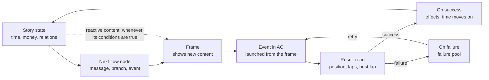

# Pit Box — Story Mode & Create Your Own: engine spec

Public, generic version of the design spec (v0.4, October 2026). It describes
what the **engine and the editor** must do, for any story. The content of the
stories themselves — characters, plot, events, places, and the settings an
author picked for a given story — is never written here: this repository is
public, and a story stays private until its release. The complete design
document, with the stories in progress, lives outside the repository.

## Summary

Story is an entry in the Pit Box rail with two doors: **Story Mode**, which
plays stories, and **Create Your Own**, the editor used to write them. Stories
come bundled with Pit Box or are imported by the player. Pit Box provides the
engine and the tools; a story is data that the engine interprets.

Every choice a story makes — period, frame, failure rules, economy, languages —
is a **setting of that story**, never a rule of the engine. The examples below
are illustrations, not the content of any planned story.

## Principles

- **Everything is written by hand.** No generated text, no AI. The engine only
  chooses which written content to show, based on the current state.
- **The illusion matters more than the simulation.** Only what the player sees
  is simulated. A price is a simple formula; an economy is a few states and
  multipliers; a motorsport world is authored results.
- **No code for the author.** Stories are built with nodes, forms, fields,
  conditions and links. Under the hood everything is saved as readable text
  files, so two people can work on the same story and every change is tracked.
- **Losing is part of the story.** A failed event never shows a "game over"
  screen; it sends the player back to the story, where people react.
- **A story can be a closed world.** It can restrict the cars and tracks that
  exist in it, so the player cannot inject others.
- **Seamless transitions.** Going from the story screen to a race and back must
  feel like one game, not a jump between programs.
- **Always validated.** The editor flags unknown variables, missing media,
  unreachable content and money dead-ends as the author works.

## Story model

A story has two layers. The **flow** is the spine: nodes linked in order,
linear or branching as the author wishes, built visually. The **reactive
content** is everything around it: messages, articles, posts and emails that
appear by themselves when their conditions are true, without being wired into
the flow.



The engine only runs this loop. Each change of state moves the flow forward if
it can, and re-checks the conditions of all reactive content.

### Flow nodes

| Node | What it does | Example |
| --- | --- | --- |
| Beat | Changes state; advances story time | Advance one month, reputation +2 |
| Message | Sends content to the frame | A character invites the player to a race |
| Event | Launches a session in AC; has a success and a failure exit | Race 01, required finish P1 |
| Branch | Checks the state and takes one path; no UI | Money ≥ 1 500? |
| Player action | Waits for the player to do something in the frame | Buy a car from a listing |
| Side events | Opens repeatable paid events that do not advance the story | Paid track days |

Branches can split the flow and join it again later, so a story can stay
authored and mostly linear while still reacting to choices.

**The engine computes, the frame shows.** What a player action does to the
state (pay for a car, add it to the garage) is computed by the engine; the
frame only reports what the player chose. The balance simulator plays with no
frame at all, so a rule kept in the frame would have to be written twice.

### Reactive content

Each item has a content type, a sender, conditions (all must be true, some can
be exclusions), an optional delay, a priority and a repeat rule. Examples: an
email from a sponsor once reputation passes a threshold; an article about a
driver in a given year. A variant (a character reacting badly when the
relation is poor) is simply another item with opposite conditions.

Reactive content is checked after every change of state. A delay counts in
story time, so a delayed item arrives at the first time move past it, if its
conditions still hold then. An item arrives once, or, if the author says so,
again each time its conditions become true anew.

### Story time

Story time is a date that only moves when a Beat node says so, usually right
after a successful event. Failing or retrying therefore never costs time,
unless the author puts a Beat on the failure path. How the date is shown is a
story setting: a real date chosen by the author, a relative one (year N of the
story), seasons, or no date at all. Messages carry an in-story day and clock
time.

**Seasons and breaks are content, not settings.** When the player races
depends on the moment of the story: each championship defines its own season
(which months it races); between seasons the flow simply runs months with no
event.

### Variables

- **Built in**: story time, chapter, reputation, followers, owned cars; and,
  when the story has an economy, money, wealth level (derived from money and
  assets), economy state and garage slots.
- **Relations**: one per character, on a closed scale (enemy → close), easier
  for an author than a number. The scale is a story setting: five steps by
  default, any ordered list of names otherwise.
- **Flags**: free true/false values.
- **Counters**: free whole numbers ("third visit to the garage"), each with
  its starting value.
- **Automatic facts**: every event exposes attempts, finished, position, best
  lap and DNF; every content item exposes whether it was seen and which reply
  was chosen.

### Content types, templates and frames

How a story is shown is the story's choice, not a rule of the engine. A story
set before mobile phones still has letters, a landline, newspapers and
classified ads. So content is written by **type**, never by app, and a
**frame** decides how each type is shown.

**Content types**: message, call, mail, article, social post, video, listing,
statement, calendar entry. The author writes "a message from a character",
never "an SMS".

**Five templates** display them, whatever the era: thread, inbox, feed,
catalog, statement. A newspaper is a feed; classified ads are a catalog.

**A frame** is a skin for those templates plus the overall picture around them
(a phone screen; a desk with the post, the paper and the answering machine).
Each frame declares which content types it can show:

| Content type | Phone frame | Desk frame (older period) |
| --- | --- | --- |
| Message | Messaging app | Letter, answering machine |
| Call | Incoming call | Landline |
| Article | News site | Newspaper, magazine |
| Video | Video platform | Tape, TV report |
| Listing | Used-car app | Newspaper classifieds |
| Statement | Bank app | Paper statement |
| Social post | Social network | Not available |

- **Validation.** If a story uses a content type its frame cannot show, the
  editor flags it.
- **Frames over time.** A story can change frame at chosen beats: letters, then
  a pager, a first mobile, a smartphone.
- **Frame-specific settings.** Status bar, wallpaper and UI sounds belong to the
  phone frame; another frame has its own.
- **First version.** Only the phone frame is built at first. The data model is
  frame-agnostic from day one, so other frames can be added later without
  touching the engine or existing stories.

A new app is a skin and a configuration of one of the templates within a frame,
with no code. Apps can change look as the story advances by switching skins at
chosen beats.

## Events, retries and failure

An event is written with fields:

```
Event: Race 01
Required finish: P1
On success: Reputation +2
Unlock: Conversation 06
Advance story: one month
On failure: Failure pool 01
```

**Event types.** Race, hot lap, time attack, test drive, track day. Only races
need AI opponents; the others use what AC does best.

**Success condition.** Finish position, beat a named driver, lap time under a
target, finish without DNF, or several combined.

**Failure.** The player returns to the story screen. The engine picks one or
two messages from the event's **failure pool**: variants written per character,
each with its own conditions (a teasing line only between friends, an
encouraging one from family, a "so close" line after a P2). A variant is not
repeated until the pool is used up. Whether story time freezes and the event
can be retried, or the result is final and the story carries on, is a story
setting.

A failure exit written by the author always wins. Without one, the setting
decides: *retry* (time frozen, attempts possibly limited) or *final* (the story
goes on, without what a success would have brought). A rematch is its own
event: every node using an event shares its attempts and fees.

**Retry cost.** A story can make each attempt pay the entry fee again and
damage cost repairs, or make retries free. **Side events** (repeatable, paid,
no story progress) let a player who runs short earn money without leaving the
story. The entry fee is paid at launch, so a player who cannot afford it
knows before driving.

**Hard events.** A story can help after repeated failures, automatically (for
example, lowering the opponents' skill by a step every few failures in a row,
with a cap) or as written per event (an alternative path). The balance
simulator shows where help is needed.

## Drivers

A story can have its own roster of drivers, fictional or not. It is optional:
without one, grids use filler names.

**Each driver has:** a name, nationality, age at the start, portrait, a role in
the story (friend, rival, background star, filler), an AI skill and aggression
per chapter, a livery per series, and a **career line**: one authored entry per
year (series, team, result).

**What the career line produces**, with no extra writing: standings rows for
championships the player is not in, short articles, social posts and videos,
and the driver's appearance in entry lists once their path crosses the
player's.

| Year | Career entry | Generates |
| --- | --- | --- |
| 2 | Wins a junior championship | Article, post, standings |
| 3 | [Series], [result] | Standings |
| 5 | Fights for a title | Monthly articles, videos |
| N | Joins the player's championship | Entry lists, own skill |

**Per-driver skill.** The entry list gives each named driver their own AI level
and aggression, so a rival described as fast is one the player feels on track,
not only reads about. The remaining grid slots come from a pool of filler names
at the chapter's default level.

**Standings of other series** are authored, not simulated: the author (or a CSV
import) sets final positions; the engine spreads them over the months.

## Race immersion in Assetto Corsa

AC's AI handles short races well and long ones poorly, so stories should favour
short events with clear goals, and use the characters to make each grid feel
inhabited.

- **Short formats**: sprints of 6 to 12 laps, grids of 8 to 16 cars.
- **Events without AI** where AC shines: a hot lap, testing a car before buying
  it, a track day, a time to beat.
- **Named drivers on the grid**, with their names, liveries and own skill.
- **Skill that follows the player**: each chapter sets a default field level;
  Pit Box can adjust it from the player's own lap times (a few calibration
  laps, then their history), within a global difficulty setting.
- **Track curation includes the AI**: a track enters a story only if its AI line
  works with the planned car class.

**How a session runs.** Pit Box builds the entry list (cars, skins, names,
per-driver skill and aggression), launches the session through Content Manager,
then reads the result file the game writes at the end (position, laps, best
lap, DNF). The story screen is back as soon as AC closes, already filling with
reactions.

**Prerequisite.** Fix the known Pit Box launch issue: sessions started by Pit
Box do not trigger CSP's automatic download of track configs. Per-driver AI
levels must also be confirmed on the CSP versions a story requires.

## Cinematics with CamTool

Two levels, very different in cost.

|  | Authored cinematics | "Your race" videos |
| --- | --- | --- |
| What | A scripted moment shown as footage | The race the player just drove, sent by a character |
| Replay | Recorded by the author, shipped in the package | The player's own replay, saved at the end of the session |
| Cameras | A CamTool file made for that replay | Per-track camera sets authored once, plus an automatic director |
| Effort | Content work, little engineering | A CamTool 3 feature: the "virtual operator" |

**Why "your race" is harder.** A CamTool file is written for one specific
replay. To cut any replay, each track needs a set of camera positions (like a
TV broadcast), and a director that picks the camera, follows the player's car
and lingers on key moments: overtakes, contact, the finish. The director logic
belongs in CamTool 3.

**How the player watches.** Opening the video in the frame plays the replay
inside AC through a CSP app, with the cameras and the music, then returns to
the story. Rendering a real video file is possible later but not needed for the
effect.

## Content: story package and dependencies

A story chooses how its content reaches the player:

|  | Bundled package | Dependency list |
| --- | --- | --- |
| Model | Closed, curated, version-controlled | Open |
| Content | One **story package**, downloaded once | A dependency list |
| Player experience | Story Mode → Required content package → Download | Pit Box checks the library; missing items get the Missing Content flow |
| Permissions | Asked to each modder, recorded in the editor | The author links to each mod's own source |

**What a package holds.** Only what the story needs: selected cars and tracks,
CSP configs, frame UI and HUD, character images, sounds and music, CamTool
camera files and replays. Kunos content stays out (every player has it); the
DLCs required are listed.

**Permission register.** The editor's Package screen lists every item with its
author and a permission status (granted, requested, not asked, not needed). An
item without permission blocks the build.

**Installation and updates: requirements now, mechanism at implementation.**
Pit Box's existing versions, layers and library export/import are the natural
starting points. Whatever the mechanism, it must meet these requirements:

- One action installs everything a story needs before play.
- The player's own mods and versions stay untouched: nothing renamed, nothing
  overwritten.
- A story can change a mod for itself only (hide a building, a track that
  changes over the years) without copying the whole mod.
- The package downloads from any URL the author gives, with no dependence on a
  particular host.
- Updates download only what changed; a new player gets the latest complete
  package; files are checked after download.

**Dependency list.** The story names cars, tracks and assets with version
fingerprints and known sources; Pit Box's Missing Content state guides the
player to each one.

## Create Your Own: the editor

The editor lives under the Story rail entry, next to Story Mode. Its interface
follows the app's language like every Pit Box screen; the languages of a story
are a separate matter (see Languages).

### Access

Create Your Own is **reserved at first**, behind a switch, and opened to all
users later.

- **Same app, hidden feature.** The editor needs the engine, the library, the
  session launcher and the frame preview; a separate tool would duplicate all of
  them. It ships inside Pit Box.
- **The switch.** Always on under `tauri dev`. In a built installer, the Story
  entry appears only once Pit Box has been launched with
  `--enable-story-studio`, which records `pitbox.story.studio` in
  `ui_prefs.json` (`--disable-story-studio` removes it).
- **Not a security measure.** Pit Box is open source, so the editor's code is
  public anyway. The switch only keeps an unfinished tool out of users' way.
- **What must stay secret is the story.** It lives in its own private
  repository, never in this one; the editor opens it from a folder on the
  author's machine. Once a story is released, its package reaches players and
  its text can be read by anyone who opens the files.

| Screen | Purpose | Key points |
| --- | --- | --- |
| Story flow | Build the spine, chapter by chapter | Nodes linked by arrows; an event has a success and a failure exit; the selected node's fields in a side panel; the chapter's reactive content listed below |
| Timeline | See the whole story across the years | One lane per arc; conditional items dashed; a cursor showing the simulated state at any point |
| Content | Write a message, email, article or post | Placement (in the flow, or reactive with conditions); conversations as a form of bubbles and choices, with a Script view for fast typing; live preview in the frame |
| Events | Define an event | Track, car, session, grid with per-driver skill, success condition, success effects, failure pool, retry cost |
| Drivers | The story's drivers (optional) | Roster, skill per chapter, career line per year, standings import |
| World | Variables, characters, economy | Variables and where they are used; character sheets; price formulas, economy states, world events |
| Balance | Test the numbers | Simulator by player profile (below) |
| Package | The curated content | Items, authors, permissions, build, requirements, what the player sees |
| Catalogs | What can be bought | By wealth level or seller; price, picture, gameplay effect (e.g. +2 garage slots) |
| Media | Pictures, music, replays | Where each file is used; unused or missing files flagged |
| Scenes | What is behind the frame | Places with variants by season, time, weather and mood; ambient sound; blur; player-view preview; when each scene is available |
| Frame | What shows the story | Frames over the story, content types each one shows; for the phone frame: status bar presets, wallpapers, UI sounds |
| Economy | Money in and out | Loans and repayments, debt recovery order, resale values, side income, written stock prices |
| Settings | The rules of this story | Languages and translation progress, saves, adaptive difficulty, calendar, branching warning, money options |

**Playtest** is the most useful tool for an author: it opens the player view
inside the editor at any point of the story, with a chosen state. Events can be
resolved by typing a result ("P3, best lap 1:18.2", "failed twice") so years of
story can be checked in minutes without driving.

**Validation** runs continuously: unknown variable, missing media, content
never reached, contradictory conditions, event whose car or track is not in the
package. Errors block the build. A diagnostic about a flow node selects it;
the others name their file. The messages are the engine's, in English, while
the editor is reserved; they are translated when it opens to all.

### Where a story lives, and how the editor writes it

- **A story is a folder of the author's choosing**, often a private git
  repository. Pit Box keeps only the list of those folders
  (`app_config_dir/story/studio.json`); removing a story from the list leaves
  its files where they are.
- **A new story needs an empty folder**: the editor never mixes a story into
  files it did not write. It starts as the smallest story with nothing to
  fix, a chapter whose first node leads to an end, written in the app's
  language.
- **Every change is written at once**, the whole file, in one canonical form,
  so a diff shows only what changed. Comments typed by hand in a file the
  editor writes do not survive.
- **A file changed outside Pit Box since the editor read it is never
  overwritten**: the story is read again, and the author is told their last
  change did not go through.
- **A sentence the engine cannot read is not written**: the change stays on
  screen, marked as not saved, until it reads.
- **Renaming a node renames every link to it**, in every chapter. The start
  node keeps its id in the flow: it is set in the story settings.
- **A section appears with the lot that builds it**, never as an entry that
  opens nothing. The first is the Story flow.

### Story flow screen

A chapter's nodes read top to bottom, in the order they play; an arrow appears
only where a node goes elsewhere (a branch case, a failure exit, an explicit
next). The column is laid out by that order: no box is placed by hand, so
nothing about the layout is stored and the files change only when the story
does. A freely arranged canvas, if a story needs one, belongs with the
Timeline.

## File format

The author never needs to see these files, but they are what makes a story
shareable, diffable and safe to edit by two people. The editor reads and writes
them; a published story is the folder zipped as a `.pitstory`.

```
my-story/
  story.yaml            title, authors, version, languages, settings, required Pit Box / CSP versions
  flow/
    01-chapter.yaml     nodes and links of chapter 1
    02-chapter.yaml
  content/
    <character>/conv_06.story
    pools/fail_01.story
  events/
    race_01.yaml
  drivers/              optional
    roster.yaml         drivers, skill per chapter
    careers.yaml        one line per driver per year
  world/
    variables.yaml  characters.yaml  economy.yaml
  catalogs/
    wealth_01.yaml
  frames/
    frames.yaml         frames used over the story, their apps and skins
  package/
    manifest.yaml       items, versions, checksums, authors, permissions
  media/
    photos/ avatars/ scenes/ music/ replays/ camtool/
```

A `.story` file is a small header (id, content type, sender, placement or
conditions, delay) followed by the text of that content.

### Engine file format

The reference is the sample story, `src-tauri/crates/story-engine/sample/`: it
uses every part of the format and the tests play it to its end. What is not
visible in it:

- Unknown keys are errors, so a misspelt field never changes a story silently.
- A flow node without `next` leads to the one written after it, then to the
  next chapter, in file-name order.
- Conditions and effects are short sentences (`reputation >= 10`,
  `rel.friend += 1`, `send conv_06`), checked against the story as it loads.
- Saves are JSON with a format number: a save from a newer Pit Box is refused.

### Dialogue text: Ink, in one language first

**Decided (October 2026).** The text inside each conversation, email or
failure pool is written in [Ink](https://github.com/inkle/ink), inkle's
open-source narrative scripting language (MIT licence), and stories are
written in **one language** until the whole concept is proven in it.
Translation comes after; its format will be chosen then, between Ink with an
id on every line and a format of Pit Box's own with line ids (the idea of
Yarn Spinner).

```
Friend: There is a race next weekend.
Friend: Want to come?
* [I'm in!]
    ~ effect("rel.friend += 1")
    Friend: Great, I'll pick you up at 8.
* [Not this time.]
    Friend: Your loss.
- -> DONE
```

**Why it can be revisited cheaply.** Ink has no translation system: each
language would be a full copy of the scripts, choices and effects included,
so a reply added later would have to be added once per language. The switch
to line ids must therefore stay a conversion run once on the scripts, not a
rewrite. Three rules keep it so:

- **Ink only inside one content item.** The flow, events, drivers, reactive
  conditions and the package stay in Pit Box's editor, so progression is
  decided in one place.
- **A subset of Ink, the one the Form view writes**: lines (each starting
  with who speaks), choices, what a choice changes, lines and choices shown
  on a condition, and joining up again after a choice. Anything else in the
  Script view is an error: the subset is what a later format must be able to
  hold.
- **No variables of Ink's own.** A script reads and changes the story's state
  only through the story's own conditions and effects, the same sentences as
  everywhere else (`check("rel.friend >= warm")`, `effect("money -= 50")`),
  checked against the story like the others. An author learns one way to
  write a condition, and the conversion has nothing to translate.

**The engine runs the script, the frame shows the lines**, as for every rule
of the story: the balance simulator plays conversations with no frame. The
Rust compiler and runtime [blade-ink-rs](https://github.com/bladecoder/blade-ink-rs)
(Apache-2.0) make that possible inside the pure engine crate. Inky, inkle's
editor, can still be used to type a script; its preview knows nothing of the
story's state.

**Alternatives considered.** Yarn Spinner (line ids built in, but its Rust
port is a work in progress built for the Bevy game engine, and it would add a
third way of writing conditions); a format of Pit Box's own (kept for when
translation comes); Twine (made for prototyping, not for being embedded);
articy:draft X and Arcweave (visual, but they know nothing of races, money or
drivers, and would tie community stories to a third-party tool, often paid).

The `.story` container keeps separating its items with lines made of `---`,
which the subset above never contains.

## Balance simulator

The simulator plays a whole story without driving, hundreds of times, for
typical player profiles, and points to where the experience breaks. It is what
makes balancing possible for a story spanning years.

**Profiles.** Each profile describes a player: how their finishing positions
are spread, how they spend (early, when affordable, saves) and how they answer
choices. Three by default: Rookie, Average, Fast. Event results are drawn from
the profile, so a Rookie needs several attempts at a hard event.

**What it shows.** The money curve per profile with economic events; attempts
per event and real hours per chapter; the median date of each milestone; for
each content item, the share of runs where it is seen.

**Warnings.**

| Warning | Meaning |
| --- | --- |
| Can't afford a retry | After failing, the player cannot pay the event again and no side event can cover it quickly |
| Too many attempts | Median attempts above a threshold: the grid's skill is out of reach for that profile |
| No money pressure | More than N months without a reachable financial goal |
| Never reached | Content seen in 0 % of runs for a profile (mark it optional if intended) |
| Dead catalog | A catalog opens long before its first item is affordable |
| Quiet story | More than N months of story time without any message |

Any warning can be marked "intended". An author's design goal (money should
often be tight, for instance) becomes a rule the simulator checks.

## Story Mode: player side

The player side follows each story's settings. What the engine needs:

- **Story hub.** The Story rail entry opens two doors: Story Mode (stories
  bundled with Pit Box and imported ones, each with its content status,
  Download, Continue, New game) and Create Your Own (my stories, import).
- **The frame can be the whole game.** A story can show nothing outside its
  frame but Settings and Save & exit, over a background that shows where the
  character is.
- **Going to an event.** A card in the frame opens a short summary (car, cost,
  goal), then AC starts. When AC closes, the frame is back and fills with
  reactions, success or failure.
- **Saves** follow the story's settings (autosave, manual saves, reload or
  not). A save holds the state and the full history of what was seen, so the
  frame stays the record of the character's life. Reloading replays the same
  draws, so it is no way to fish for another line. A save resumes a story
  updated since: what the story gained starts at its starting value, and a
  save standing on something removed is refused with the reason.
- **The frame evolves.** Skins change at chosen beats.

## Scenes, frame and sound

A story can place its frame in the centre of a widescreen view, over a blurred
background that shows where the character is. Each layer below is available to
any story, and each is optional (see Story settings).

- **Scenes.** A scene is a place (a bedroom, a garage, a hotel room) with
  variants by season, time of day, weather and mood. The engine picks the
  variant from story time, the in-story clock and the current beat; a beat can
  force one. Garage scenes can show the player's current car.
- **Media.** A variant is a still image or a seamless video loop, with its
  ambient sound if any. Because the background is blurred, a modest resolution
  and bitrate are enough, which keeps the package smaller.
- **Phone state.** With the phone frame, each beat can set the status bar:
  clock, date label, battery, signal, Wi-Fi, airplane mode. The scene gives
  defaults and the beat can override them.
- **New phones.** A new phone is a change of frame placed on a beat; each phone
  frame has its own status bar style, app skins and UI sounds. Apps appear as
  the story unlocks them.
- **Sound.** Ambient loops per scene and frame UI sounds (tap, open an app,
  notification, typing, lock).
- **Assets come from anywhere.** The editor imports images, videos, sounds and
  UI elements however they were made. Each asset records its origin and
  licence, which feeds the credits and the permission register.

## Languages

Each story declares its languages, and a story can be written in several:

- Every text has a stable id; translations live beside the source language; a
  missing line falls back to it.
- The editor shows each content item in any language, counts missing lines per
  language, and exports texts for translators and imports them back.
- Not built yet: a story is written in one language until the concept is
  proven, and the translation format is chosen then (see Dialogue text).

## Story settings

A story makes strong choices that another author may not want. They are
therefore settings of a story, never rules of the engine. Two principles
follow:

- **Every immersion layer is optional.** A story with no custom art must still
  work: Pit Box ships a default phone theme and plain backgrounds, and each
  richer layer (video scenes, status bar details, phone models, sounds,
  cinematics) is added on top.
- **Each setting below is a choice among options**, with a default that suits
  a story with no custom work.

| Setting | Options |
| --- | --- |
| Background | Video loops by scene, still image, plain colour; blur or not; ambient sound or not |
| Frame | Pit Box's default phone theme, custom phone frames changing at chosen beats, or another frame |
| Status bar | Detailed per beat, or plain clock only |
| Date | Relative (year N), a real date chosen by the author, seasons, or no date |
| Protagonist | Fixed name, or a name chosen by the player and inserted in the texts |
| Failed event | Retry with story time frozen, result final and the story goes on, limited retries; retries paid or free |
| Adaptive difficulty | Off, or a step every N consecutive failures, with a cap |
| Saves | Autosave per in-story day or manual saves; reload allowed or not |
| Branching | Short branches that rejoin (with a warning), or long branches and several endings |
| Money | Off, or any of: loans, debt recovery, a stock market, side events |
| Cars | Chosen by the story or bought in its catalogues, or any car of a class from the player's library |
| Content | Closed package, or dependency list and Missing Content |
| Drivers | Fictional or real roster with careers, a small roster, or none (filler names only) |
| Calendar | Northern or southern seasons; holidays and birthdays, or none |
| Languages | One or several |
| Relations | The default five-step scale, or the story's own ordered steps |

The settings live in the `settings` part of each story's `story.yaml`.

## Delivery plan

| Lot | Content | Result |
| --- | --- | --- |
| L0 | Fix the CSP launch issue; read the race result file; entry list with per-driver skill | A session launched by Pit Box returns a usable result |
| L1 | File format, flow engine, conditions, story time, saves | The engine runs a sample story from the command line |
| L2 | Create Your Own: Story flow, Content, Events, Drivers, World, validation, preview in the phone frame | An author builds a first chapter in the editor (behind the switch) |
| L3 | Story Mode: hub, phone with thread, inbox, feed and statement templates, events with retries and failure pools | A first chapter is playable end to end |
| L4 | Story package: build, permissions, download, install and update (mechanism chosen at implementation) | A player installs a bundled story in one click |
| L5 | Playtest and Timeline | An author checks years of story in minutes |
| L6 | Balance simulator, catalogs, economy, side events | Money pressure is tuned on numbers |
| L7 | Authored cinematics: CSP playback app, replays, CamTool files, music | Scripted moments are staged |
| L8 | "Your race" videos: per-track camera sets and automatic director (CamTool 3) | A character sends the player their race |
| Later | Open Create Your Own to all users | Anyone can write and share a story |
| Later | Other frames, when a story needs them | Stories set in any era |

## Open questions

- [ ] **Translation format**: Ink with an id on every line, or a format of
      Pit Box's own with line ids, once a story is proven in one language
      (Dialogue text).
- [ ] **Updates**: mechanism chosen at implementation, against the requirements
      listed in Content.
- [ ] **Track evolution**: story layers per period (hidden objects, new
      textures) versus what CSP configs can already do (seasonal looks, hiding
      objects).
- [ ] **Platform scope**: which story settings to expose in the first version.
