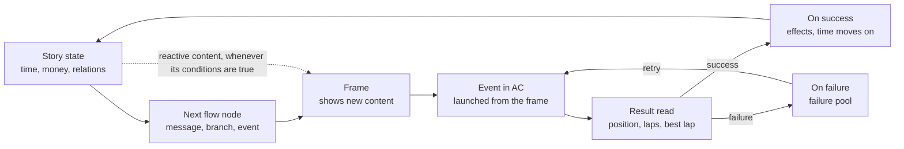

# Pit Box — Story Mode & Create Your Own: engine spec

Public, generic version of the design spec (v0.4, October 2026). It describes
what the **engine and the editor** must do, for any story. The content of the
stories themselves — characters, plot, events, places, and the settings an
author picked for a given story — is never written here: this repository is
public, and a story stays private until its release. The complete design
document, with the stories in progress, lives outside the repository.

## Summary

Story is an entry in the Pit Box rail with two doors: **Story Mode**, which
plays stories, and **Create Your Own**, the editor used to write them. Stories
come bundled with Pit Box or are imported by the player. Pit Box provides the
engine and the tools; a story is data that the engine interprets.

Every choice a story makes — period, frame, failure rules, economy, languages —
is a **setting of that story**, never a rule of the engine. The examples below
are illustrations, not the content of any planned story.

## Principles

- **Everything is written by hand.** No generated text, no AI. The engine only
  chooses which written content to show, based on the current state.
- **The illusion matters more than the simulation.** Only what the player sees
  is simulated. A price is a simple formula; an economy is a few states and
  multipliers; a motorsport world is authored results.
- **No code for the author.** Stories are built with nodes, forms, fields,
  conditions and links. Under the hood everything is saved as readable text
  files, so two people can work on the same story and every change is tracked.
- **Losing is part of the story.** A failed event never shows a "game over"
  screen; it sends the player back to the story, where people react.
- **A story can be a closed world.** It can restrict the cars and tracks that
  exist in it, so the player cannot inject others.
- **Seamless transitions.** Going from the story screen to a race and back must
  feel like one game, not a jump between programs.
- **Always validated.** The editor flags unknown variables, missing media,
  unreachable content and money dead-ends as the author works.

## Story model

A story has two layers. The **flow** is the spine: nodes linked in order,
linear or branching as the author wishes, built visually. The **reactive
content** is everything around it: messages, articles, posts and emails that
appear by themselves when their conditions are true, without being wired into
the flow.



The engine only runs this loop. Each change of state moves the flow forward if
it can, and re-checks the conditions of all reactive content.

### Flow nodes

| Node | What it does | Example |
| --- | --- | --- |
| Beat | Changes state; advances story time; can change or remove the frame | Advance one month, reputation +2 |
| Message | Sends content to the frame, or plays a dialogue on the scene; can have one exit per reply | A character invites the player to a race |
| Event | Launches a session in AC; has a success and a failure exit | Race 01, required finish P1 |
| Branch | Checks the state and takes one path; no UI | Money ≥ 1 500? |
| Player action | Waits for the player to do something in the frame | Buy a car from a listing |
| Side events | Opens repeatable paid events that do not advance the story | Paid track days |

Branches can split the flow and join it again later, so a story can stay
authored and mostly linear while still reacting to choices.

**The engine computes, the frame shows.** What a player action does to the
state (pay for a car, add it to the garage) is computed by the engine; the
frame only reports what the player chose. The balance simulator plays with no
frame at all, so a rule kept in the frame would have to be written twice.

### Reactive content

Each item has a content type, a sender, conditions (all must be true, some can
be exclusions), an optional delay, a priority and a repeat rule. Examples: an
email from a sponsor once reputation passes a threshold; an article about a
driver in a given year. A variant (a character reacting badly when the
relation is poor) is simply another item with opposite conditions.

Reactive content is checked after every change of state. A delay counts in
story time, so a delayed item arrives at the first time move past it, if its
conditions still hold then. An item arrives once, or, if the author says so,
again each time its conditions become true anew.

### Story time

Story time is a date that only moves when a Beat node says so, usually right
after a successful event. Failing or retrying therefore never costs time,
unless the author puts a Beat on the failure path. How the date is shown is a
story setting: a real date chosen by the author, a relative one (year N of the
story), seasons, or no date at all. Messages carry an in-story day and clock
time.

**Seasons and breaks are content, not settings.** When the player races
depends on the moment of the story: each championship defines its own season
(which months it races); between seasons the flow simply runs months with no
event.

### Variables

- **Built in**: story time, chapter, reputation, followers, owned cars; and,
  when the story has an economy, money, wealth level (derived from money and
  assets), economy state and garage slots.
- **Relations**: one per character, on a closed scale (enemy → close), easier
  for an author than a number. The scale is a story setting: five steps by
  default, any ordered list of names otherwise.
- **Flags**: free true/false values.
- **Counters**: free whole numbers ("third visit to the garage"), each with
  its starting value.
- **Automatic facts**: every event exposes attempts, finished, position, best
  lap and DNF; every content item exposes whether it was seen and which reply
  was chosen (by the reply's label, see Dialogue text).

### Content types, templates and frames

How a story is shown is the story's choice, not a rule of the engine. A story
set before mobile phones still has letters, a landline, newspapers and
classified ads. So content is written by **type**, never by app, and a
**frame** decides how each type is shown.

**Content types**: message, call, mail, article, social post, video, listing,
statement, calendar entry, **dialogue** (two or more characters talking face
to face, see In-person dialogues), **illustration** (a full-screen picture,
same section) and **document** (something read in person: a newspaper, a
letter, a contract). The author writes "a message from a
character", never "an SMS".

**Seven templates** display them, whatever the era: thread, inbox, feed,
catalog, statement, agenda and dialogue. Classified ads are a catalog; a
championship calendar is an agenda (entries dated in story time).

- **Layouts.** A template can have several layouts, all shipped by Pit Box:
  a feed is a `list` (a social network, a news site) or a `page` (a newspaper
  or magazine page: masthead, columns, headline, photos). A layout belongs to
  Pit Box, never to a story: one that no template has is added to Pit Box, for
  every story.
- **A call** is written like a dialogue - same Ink, same labelled replies -
  and plays in the frame's call screen: the dialogue template inside the frame.
- **On the scene.** A dialogue, an illustration and a document play on the
  scene, outside the frame, which slides away meanwhile; they need no frame.
  A document uses the `page` layout (a newspaper) or a `letter` one, with its
  own skin.

**A frame** is a skin for those templates plus the overall picture around them
(a phone screen; a desk with the post, the paper and the answering machine).
Each frame declares which content types it can show:

| Content type | Phone frame | Desk frame (older period) |
| --- | --- | --- |
| Message | Messaging app | Letter, answering machine |
| Call | Incoming call | Landline |
| Article | News site | Newspaper, magazine |
| Video | Video platform | Tape, TV report |
| Listing | Used-car app | Newspaper classifieds |
| Statement | Bank app | Paper statement |
| Social post | Social network | Not available |
| Calendar entry | Calendar app | Wall calendar, diary |
| Document | On the scene | On the scene |

- **The frame is part of the state.** The start state in `story.yaml` holds the
  starting frame, alongside the starting date and money; a Beat node can change
  it or remove it (`none`). **There is no default frame**: the author picks the
  starting frame when creating the story, and nothing is picked for them - the
  phone is one frame among others, never the platform's choice. A story with
  no frame at all is a visual novel.
- **Frames over time.** A story can change frame at chosen beats: letters, then
  a pager, a first mobile, a smartphone.
- **Nowhere to show.** Content of a type the active frame cannot show (or sent
  while there is no frame) is flagged by the checks wherever the flow makes it
  knowable, as a warning: on a path where it is sure, or on some paths only.
  At play, it waits, kept in the save and not delivered - its `delivered`
  fact stays false - until a Beat puts up a frame that can show it; several
  come out in the order they were sent, dated when they show (as the frame
  goes up, before the Beat's effects), reactive content without its
  conditions being checked again. A Message node whose content waits does not
  hold the flow. The editor's preview plays an item wherever it would arrive.
  A dialogue needs no frame.
- **Frame-specific settings.** Status bar, wallpaper and UI sounds belong to the
  phone frame; another frame has its own.
- **First version.** Only the phone frame is built at first. The data model is
  frame-agnostic from day one, so other frames can be added later without
  touching the engine or existing stories.

A new app is a skin and a configuration of one of the templates within a frame,
with no code. Apps can change look as the story advances by switching skins at
chosen beats.

### Skins: how a frame gets its look

A skin is images, colours, fonts and sounds placed on a template. It never
changes what the template does, and it never contains code.

- **Frames and apps** are declared in `frames/frames.yaml`. A frame names the
  kind Pit Box ships it builds on (`phone` so far), its body image with the
  screen area (a rectangle in the image's pixels, and the corners' radius),
  its wallpaper, its status bar style and its UI sounds, then its apps. An app
  has an id, a name, an icon, a template and a layout, the content types it
  shows, a skin, and when it appears (with its first item, or from a Beat).
- **A skin** is a folder, `frames/skins/<id>/`, holding `skin.yaml` and its
  files. It is self-contained, so a skin can be copied from one story to
  another. `skin.yaml` gives the colours, the fonts and the **slots** it fills.
- **Slots** are the named places each template and layout offers: for a
  thread, its background, header, incoming and outgoing bubbles, avatar mask
  and reply button; for a `page`, its paper, masthead, column rule and photo
  frame; for the dialogue, its text box, name plate and choices; and so on
  for every template. The full list per template is kept with the starter kit
  (below) and checked by the engine.
- **Images** are PNG or WebP, drawn at a reference size (the phone screen
  1080 px wide, the scene 1920 × 1080) and scaled. A slot that must stretch
  (a bubble, a header, a text box) declares its four fixed margins (9-slice),
  so a hand-drawn edge stays as drawn.
- **Fonts** (TTF, OTF, WOFF2) come with the story, their licence recorded like
  any asset's. Text always stays text over the skin, never inside an image:
  it is translated and it changes with the state.
- **What is missing falls back.** A slot left empty takes the frame's default
  theme, so a skin can start with one image. A slot no template has, or a file
  that is not there, is flagged by the checks.
- **No code, on purpose**: no HTML, CSS, JavaScript or shader in a story. A
  shared story is a downloaded file, and code in it would be a risk for the
  player; and a story that only fills slots keeps working as Pit Box evolves.
- **Over time**, a Beat puts up another frame (a new phone) or swaps an app's
  skin.
- **The starter kit.** For each template and layout, a template sheet (PNG and
  SVG) shows the slots, their reference sizes, the stretch margins and the
  safe areas. The author draws over it, cuts the pieces and drops them in the
  Frame screen. The sheets ship with Pit Box and can be saved from the Frame
  screen.
- **The Frame screen** lists a frame's apps and, for each, its slots as drop
  zones, with a live preview filled with sample content and the checks
  (missing file, wrong ratio, image too small for its reference size).
- **The author guide**, `docs/story/authoring/`, explains step by step how to
  make a frame, an app and a skin, pointing at the sample story's files. It is
  generic, so it lives in the repository, and it is written by the lot that
  builds skins, against what was built.

### In-person dialogues and visual novels

A dialogue is a conversation face to face, shown the way visual novels do: the
scene is the set, the characters appear as portraits, the lines come in a text
box at the bottom, the player's replies as choices. While it plays the frame
slides out of view and the scene's blur is reduced; when it ends the frame
comes back. Nothing in it is specific to a frame, so it works with any frame and
with none.

- **Written like any conversation.** Same Ink subset, same Form and Script
  views, same conditions and effects, same placement (a Message node in the
  flow, or reactive content). The header of the `.story` item adds the scene
  (optional: the current scene otherwise) and the characters present
  (`characters`); whoever speaks must be among them. A dialogue with choices
  always holds the flow until it ends. Its scene is a place of
  `scenes/scenes.yaml` (see Scenes, frame and sound).
- **Portraits.** A character has one portrait per expression (at least
  `neutral`), picked from the story's media: a file inside `media/`, which the
  checks look for. A line can name the speaker's
  expression and position with Ink tags (`#expression:happy
  #position:left`), checked against the character's portraits.
- **On stage.** Every character present stands from the first line; one who
  speaks without being listed steps in when they first speak; a line tagged
  `#leave` is the speaker's last on stage - gone from the next line, back if
  they speak again. Without a
  position they stand in the order listed - left, right, then centre - and a
  position given stays for their next lines. A face is `neutral` until a line
  names an expression, which stays for that character's next lines. The
  speaker is put forward, the others dimmed; the next line shows on a click,
  Space or Enter, the left arrow goes back a line, and the replies show once
  the last line is read.
- **Replies that branch.** Every choice carries a stable Ink label
  (`* (yes) [I'm in!]`). The label is the "reply chosen" fact, readable by any
  condition, and a Message node can have **one exit per label**, shown like the
  cases of a Branch (an arrow only where a reply leads elsewhere). Effects on
  the state remain possible in addition, for consequences that come later.
  A conversation can have several choice points: `content.<id>.reply == yes`
  holds when `yes` was chosen at any of them, and when the conversation ends
  the node leaves by the exit of **the most recent reply that has one**,
  otherwise by its `next`. Delivering an item again starts a new conversation
  and forgets the replies of the last one, and that it was seen.
- **Stories with no frame.** When the active frame is `none`, the flow chains
  dialogues and events directly; an event is launched from a card shown on the
  scene (the same summary as in the frame: car, cost, goal); the player's
  actions go through the replies, so an Action node reached with no frame is
  flagged by the checks, as a warning: at play, a Done button stands in.
- **What visual novels expect, always available, with no setting**: a
  scrollable log of past lines (part of the save's history), fast-forward
  through text already read (never past a choice), auto-advance at a speed the
  player picks. Saving at any moment during a dialogue follows the story's
  `saves` setting.
- **Illustrations.** A content type `illustration` shows a full-screen picture,
  with optional text, for the big moments, with or without a frame. Its
  `picture` is a file inside `media/`, checked like a portrait; its text says
  what it shows and offers no reply, so it never holds the flow. On the
  scene, dialogues and illustrations play one after the other, in the order
  they came, each until the player closes it.
- **Transitions** are options in the editor, never story settings: fade or cut
  between scenes, a portrait entering or leaving, a change of expression.
  Today a dialogue or an illustration says `transition: cut`, or nothing for
  a fade: how it comes on the scene and leaves it and, for a dialogue, how
  its portraits come, go and change face. Between scenes waits for the
  scenes.
- **Seeing the shape of a branching story.** The Story flow screen stays a
  column for editing. A read-only graph view, laid out automatically each time
  it opens (nothing stored), shows a chapter as a map: branches side by side,
  where they join, the endings. A click on a box opens that node in the column.
  A node stands below everything leading to it; a loop is drawn as a dashed
  return beside the boxes; a way out to another chapter ends on a box naming
  the node it goes to, which opens that node in its chapter.

## Events, retries and failure

An event is written with fields:

```
Event: Race 01
Required finish: P1
On success: Reputation +2
Unlock: Conversation 06
Advance story: one month
On failure: Failure pool 01
```

**Event types.** Race, hot lap, time attack, test drive, track day. Only races
need AI opponents; the others use what AC does best.

**The session.** An event names its track (and layout) and its car, picked in
the player's library, and the few settings of the session the author decides:
time of day and weather; for a race only, laps, cars on the grid (the
player's included), opponents' skill and the player's start. What the author
leaves unset is Pit Box's default; what the event does not cover at all
(assists, damage, tyre wear) is the player's. A race's **grid is the
author's**: opponents placed one by one, each with a car, a livery, a driver
of the story's roster and a skill, in the table of Pit Box's own session
screen. An opponent without a car drives the event's; without a livery, the
launcher picks one; without a driver, it races under the livery's name;
without a skill, it has its driver's, else the event's. When the event asks
for more cars than the author placed, the other slots drive the event's car
under filler names; when it does not say, the placed opponents are the whole
field. Where this is going: the author decides **setting by setting** whether
it is imposed or left to the player; and the car is either **imposed** or
**chosen by the player in their story garage**, possibly among a list the
author allows.

**Success condition.** Finish position, beat a named driver, lap time under a
target, finish without DNF, or several combined. A named driver to beat is one
the event's grid places: any other would make the event impossible to win.

**Failure.** The player returns to the story screen. The engine picks one or
two messages from the event's **failure pool**: variants written per character,
each with its own conditions (a teasing line only between friends, an
encouraging one from family, a "so close" line after a P2). A variant is not
repeated until the pool is used up. Whether story time freezes and the event
can be retried, or the result is final and the story carries on, is a story
setting.

A failure exit written by the author always wins. Without one, the setting
decides: *retry* (time frozen, attempts possibly limited) or *final* (the story
goes on, without what a success would have brought). A rematch is its own
event: every node using an event shares its attempts and fees.

**Retry cost.** A story can make each attempt pay the entry fee again and
damage cost repairs, or make retries free. **Side events** (repeatable, paid,
no story progress) let a player who runs short earn money without leaving the
story. The entry fee is paid at launch, so a player who cannot afford it
knows before driving.

**Hard events.** A story can help after repeated failures, automatically (for
example, lowering the opponents' skill by a step every few failures in a row,
with a cap; a step is 2 points of skill) or as written per event (an alternative path). The balance
simulator shows where help is needed.

## Drivers

A story can have its own roster of drivers, fictional or not. It is optional:
without one, grids use filler names.

**Each driver has:** a name, nationality, age at the start, portrait, a role in
the story (friend, rival, background star, filler), an AI skill and aggression
per chapter, a livery per series, and a **career line**: one authored entry per
year (series, team, result).

**Today** a driver has a name, a nationality (a country as the game names it),
an age, a role, one skill and one aggression; a driver can **be a character**,
whose name they take when they have none of their own, and a character is at
most one driver. The skill per chapter, the livery per series, the career line and the
standings come later; the livery is the grid's, opponent by opponent.

**What the career line produces**, with no extra writing: standings rows for
championships the player is not in, short articles, social posts and videos,
and the driver's appearance in entry lists once their path crosses the
player's.

| Year | Career entry | Generates |
| --- | --- | --- |
| 2 | Wins a junior championship | Article, post, standings |
| 3 | [Series], [result] | Standings |
| 5 | Fights for a title | Monthly articles, videos |
| N | Joins the player's championship | Entry lists, own skill |

**Per-driver skill.** The entry list gives each named driver their own AI level
and aggression, so a rival described as fast is one the player feels on track,
not only reads about. The remaining grid slots come from a pool of filler names
at the chapter's default level.

**Standings of other series** are authored, not simulated: the author (or a CSV
import) sets final positions; the engine spreads them over the months.

## Race immersion in Assetto Corsa

AC's AI handles short races well and long ones poorly, so stories should favour
short events with clear goals, and use the characters to make each grid feel
inhabited.

- **Short formats**: sprints of 6 to 12 laps, grids of 8 to 16 cars.
- **Events without AI** where AC shines: a hot lap, testing a car before buying
  it, a track day, a time to beat.
- **Named drivers on the grid**, with their names, liveries and own skill.
- **Skill that follows the player**: each chapter sets a default field level;
  Pit Box can adjust it from the player's own lap times (a few calibration
  laps, then their history), within a global difficulty setting.
- **Track curation includes the AI**: a track enters a story only if its AI line
  works with the planned car class.

**How a session runs.** Pit Box builds the entry list (cars, skins, names,
per-driver skill and aggression), launches the session through Content Manager,
then reads the result file the game writes at the end (position, laps, best
lap, DNF). The story screen is back as soon as AC closes, already filling with
reactions.

**Prerequisite.** Fix the known Pit Box launch issue: sessions started by Pit
Box do not trigger CSP's automatic download of track configs. Per-driver AI
levels must also be confirmed on the CSP versions a story requires.

## Cinematics with CamTool

Two levels, very different in cost.

|  | Authored cinematics | "Your race" videos |
| --- | --- | --- |
| What | A scripted moment shown as footage | The race the player just drove, sent by a character |
| Replay | Recorded by the author, shipped in the package | The player's own replay, saved at the end of the session |
| Cameras | A CamTool file made for that replay | Per-track camera sets authored once, plus an automatic director |
| Effort | Content work, little engineering | A CamTool 3 feature: the "virtual operator" |

**Why "your race" is harder.** A CamTool file is written for one specific
replay. To cut any replay, each track needs a set of camera positions (like a
TV broadcast), and a director that picks the camera, follows the player's car
and lingers on key moments: overtakes, contact, the finish. The director logic
belongs in CamTool 3.

**How the player watches.** Opening the video in the frame plays the replay
inside AC through a CSP app, with the cameras and the music, then returns to
the story. Rendering a real video file is possible later but not needed for the
effect.

## Content: story package and dependencies

A story chooses how its content reaches the player:

|  | Bundled package | Dependency list |
| --- | --- | --- |
| Model | Closed, curated, version-controlled | Open |
| Content | One **story package**, downloaded once | A dependency list |
| Player experience | Story Mode → Required content package → Download | Pit Box checks the library; missing items get the Missing Content flow |
| Permissions | Asked to each modder, recorded in the editor | The author links to each mod's own source |

**What a package holds.** Only what the story needs: selected cars and tracks,
CSP configs, frame UI and HUD, character images, sounds and music, CamTool
camera files and replays. Kunos content stays out (every player has it); the
DLCs required are listed.

**Permission register.** The editor's Package screen lists every item with its
author and a permission status (granted, requested, not asked, not needed). An
item without permission blocks the build.

**Installation and updates: requirements now, mechanism at implementation.**
Pit Box's existing versions, layers and library export/import are the natural
starting points. Whatever the mechanism, it must meet these requirements:

- One action installs everything a story needs before play.
- The player's own mods and versions stay untouched: nothing renamed, nothing
  overwritten.
- A story can change a mod for itself only (hide a building, a track that
  changes over the years) without copying the whole mod.
- The package downloads from any URL the author gives, with no dependence on a
  particular host.
- Updates download only what changed; a new player gets the latest complete
  package; files are checked after download.

**Dependency list.** The story names cars, tracks and assets with version
fingerprints and known sources; Pit Box's Missing Content state guides the
player to each one.

## Create Your Own: the editor

The editor lives under the Story rail entry, next to Story Mode. Its interface
follows the app's language like every Pit Box screen; the languages of a story
are a separate matter (see Languages).

### Access

Create Your Own is **reserved at first**, behind a switch, and opened to all
users later.

- **Same app, hidden feature.** The editor needs the engine, the library, the
  session launcher and the frame preview; a separate tool would duplicate all of
  them. It ships inside Pit Box.
- **The switch.** Always on under `tauri dev`. In a built installer, the Story
  entry appears only once Pit Box has been launched with
  `--enable-story-studio`, which records `pitbox.story.studio` in
  `ui_prefs.json` (`--disable-story-studio` removes it).
- **Not a security measure.** Pit Box is open source, so the editor's code is
  public anyway. The switch only keeps an unfinished tool out of users' way.
- **What must stay secret is the story.** It lives in its own private
  repository, never in this one; the editor opens it from a folder on the
  author's machine. Once a story is released, its package reaches players and
  its text can be read by anyone who opens the files.

| Screen | Purpose | Key points |
| --- | --- | --- |
| Story flow | Build the spine, chapter by chapter | Nodes in a column, in playing order; an event has a success and a failure exit, a Message node one exit per reply; a Beat sets the frame; the selected node's fields in a side panel; the chapter's reactive content listed below; later, a read-only graph view laid out automatically |
| Timeline | See the whole story across the years | One lane per arc; conditional items dashed; a cursor showing the simulated state at any point |
| Content | Write a message, email, article, post or dialogue | Placement (in the flow, or reactive with conditions); conversations as a form of bubbles and choices, with a Script view for fast typing; live preview in the frame, or on the scene for a dialogue (portraits, text box, replies) |
| Events | Define an event | Track, car, session, grid with per-driver skill, success condition, success effects, failure pool, retry cost |
| Drivers | The story's drivers (optional) | Roster, skill per chapter, career line per year, standings import |
| World | Variables, characters, economy | Variables and where they are used; character sheets; price formulas, economy states, world events |
| Balance | Test the numbers | Simulator by player profile (below) |
| Package | The curated content | Items, authors, permissions, build, requirements, what the player sees |
| Catalogs | What can be bought | By wealth level or seller; price, picture, gameplay effect (e.g. +2 garage slots) |
| Media | Pictures, music, replays | Where each file is used; unused or missing files flagged |
| Scenes | What is behind the frame | Places with variants by season, time, weather and mood; ambient sound; blur; player-view preview; when each scene is available |
| Frame | What shows the story | Frames over the story, their apps and the content types each shows; each app's skin as slots to drop images in, with a live preview and the starter kit's sheets; for the phone frame: status bar presets, wallpapers, UI sounds |
| Economy | Money in and out | Loans and repayments, debt recovery order, resale values, side income, written stock prices |
| Settings | The rules of this story | Languages and translation progress, saves, adaptive difficulty, calendar, branching warning, money options |

**Playtest** is the most useful tool for an author: it opens the player view
inside the editor at any point of the story, with a chosen state. Events can be
resolved by typing a result ("P3, best lap 1:18.2", "failed twice") so years of
story can be checked in minutes without driving.

**Validation** runs continuously: unknown variable, missing media, content
never reached, contradictory conditions, event whose car or track is not in the
package. Errors block the build. A diagnostic about a flow node selects it;
the others name their file. The messages are the engine's, in English, while
the editor is reserved; they are translated when it opens to all.

### Where a story lives, and how the editor writes it

- **A story is a folder of the author's choosing**, often a private git
  repository. Pit Box keeps only the list of those folders
  (`app_config_dir/story/studio.json`); removing a story from the list leaves
  its files where they are.
- **A new story needs an empty folder**: the editor never mixes a story into
  files it did not write. It starts as the smallest story with nothing to
  fix, a chapter whose first node leads to an end, written in the app's
  language, on the starting frame the author picks in the creation dialog
  (none is preselected). **Copy the sample** writes the sample story Pit Box
  carries, portraits included, into an empty folder: the author's own copy,
  to read and change and learn from; Story Mode keeps playing the sample
  Pit Box carries.
- **Every change is written at once**, the whole file, in one canonical form,
  so a diff shows only what changed: a setting left at its default is not
  written. Comments typed by hand in a file the editor writes do not survive.
- **A file changed outside Pit Box since the editor read it is never
  overwritten**: the story is read again, and the author is told their last
  change did not go through.
- **A sentence the engine cannot read is not written**: the change stays on
  screen, marked as not saved, until it reads.
- **Renaming a node renames every link to it**, in every chapter. The start
  node keeps its id in the flow: it is set in the story settings.
- **Renaming a name renames every sentence citing it**: a character, a flag,
  a counter, a relation step or a driver, in every file of the story - flow,
  events, content, the scripts' `check()` and `effect()` included; a driver
  in the grids placing them and the criteria racing against them, a
  character in the driver they are. The editor lists
  the lines citing a name, and a rename asks first when there are any. In a
  file the editor does not write yet, only the cited word changes; file and
  folder names are never renamed. Deleting a name leaves the sentences citing
  it, and the checks report them.
- **Ctrl+Z undoes the last edit, Ctrl+Y (or Ctrl+Shift+Z) redoes it**, a
  rename or a restore whole, whatever section shows; inside a text field the
  keys undo the typing instead. An edit is undone only while its files still
  hold what it wrote: a file changed outside Pit Box since is never
  overwritten, the story is read again and its history is cleared. The
  history lasts while Pit Box runs.
- **A copy of the story is taken the first time it is opened on a day**, and
  before every restore; the ten most recent are kept, in Pit Box's own data,
  never in the story's folder. A copy holds the files the editor writes, not
  the media. Restoring puts the whole story back as it was, removes the story
  files added since, and can itself be undone.
- **A name is a letter followed by letters, digits and `_`**, so that it can
  never read as a number or a yes/no. A new character's or driver's name is
  made from their display name, which can change freely afterwards: it is
  only shown.
- **The event sheet explains itself**: beside each block, a note on how to
  fill it in - the session, success, effects (their forms, and the names
  this story declares), the failure pool - and beside the event's name, its
  own checks. The opponents' table takes the whole width. Where the sheet is
  too narrow for two columns, each note goes under its block.
- **An event is a file, `events/<id>.yaml`**, created from its display name
  like a character. Renaming it renames the node launching it, the Side
  events opening or closing it, every sentence reading its facts
  (`event.<id>.position`), and its file, when the file is named after it.
  Deleting it leaves those citations, for the checks to report; Ctrl+Z
  brings it back. Its track and car are picked in the player's library; one
  the library does not have is kept as written and shown as missing. A track
  with layouts starts on its first. Changing an event's type away from a race
  drops what only a race has, its grid and the drivers to beat included.
- **A race's grid is edited in the session screen's table**, with its car
  picker: added opponents take the cars picked, replacing a car drops the
  livery of the old one, and a copied row is nobody's (a driver races once
  per grid). A driver is picked in the roster, never typed. A row shows what
  will race: the event's car, the driver's skill and nationality, when the
  row has none of its own. Every skill - the event's, a driver's, an
  opponent's - is offered in Content Manager's range, 70 to 100.
- **The Content screen previews the item it shows**, played by the engine
  on its own from the story's starting state: the flow does not move and no
  reactive content comes. The author sets the variables the item reads
  (relations, flags, counters, reputation, followers, money), chooses
  replies, and sees what the conversation changed and which items it sent.
  What is set lasts while Pit Box runs and is never written. A dialogue shows
  on the 16:9 stage (a plain background: scenes are not drawn yet), another item
  in the frame it can arrive in, in the template of the phone app showing it
  (thread, inbox, feed, statement; a type with no app yet says so), and an
  item no frame can show shows the checks' warning instead. The preview follows every save, and its views
  are Story Mode's own: the phone, its templates and the stage.
- **A content item lives in a `.story` file of `content/`**, filed as the
  author likes. A new item gets its id from the name typed and a file of its
  own, `content/<id>.story`; deleting a file's last item removes the file.
  Its text is written even with Ink errors, which the checks show line by
  line - a conversation is typed over time - but never with a line made of
  `---` alone. Its id is not renamed in the editor yet. The text shows as a
  **form** (lines, effects, choice points with their labels and what each
  leads to, the end) or as **Ink** (the Script view); the form is the tree
  the engine reads, and a text with lines outside the subset opens only in
  the Script view.
- **A section appears with the lot that builds it**, never as an entry that
  opens nothing: the Story flow, the Events, the Contents, the Drivers, the
  World (characters, flags, counters), the Settings and the story's copies so
  far. Settings shows only the settings the engine applies.
  Each section counts the errors of its own files.

### Story flow screen

A chapter's nodes read top to bottom, in the order they play; an arrow appears
only where a node goes elsewhere (a branch case, a failure exit, a reply exit,
an explicit next). A Message node's panel lists its content's reply labels,
each with the node it leads to or none (the flow goes on). The column is laid out by that order: no box is placed by hand, so
nothing about the layout is stored and the files change only when the story
does. A freely arranged canvas, if a story needs one, belongs with the
Timeline.

## File format

The author never needs to see these files, but they are what makes a story
shareable, diffable and safe to edit by two people. The editor reads and writes
them; a published story is the folder zipped as a `.pitstory`.

```
my-story/
  story.yaml            title, authors, version, languages, settings, required Pit Box / CSP versions
  flow/
    01-chapter.yaml     nodes and links of chapter 1
    02-chapter.yaml
  content/
    <character>/conv_06.story
    pools/fail_01.story
  events/
    race_01.yaml
  drivers/              optional
    roster.yaml         drivers, skill per chapter
    careers.yaml        one line per driver per year
  world/
    variables.yaml  characters.yaml  economy.yaml
  catalogs/
    wealth_01.yaml
  frames/
    frames.yaml         frames used over the story, their apps and skins
    skins/<id>/         skin.yaml and the skin's images, fonts and sounds
  scenes/
    scenes.yaml         places, their variants and ambient sounds
  package/
    manifest.yaml       items, versions, checksums, authors, permissions
  media/
    photos/ avatars/ scenes/ music/ replays/ camtool/
```

A `.story` file is a small header (id, content type, sender, placement or
conditions, delay) followed by the text of that content.

### Engine file format

The reference is the sample story, `src-tauri/crates/story-engine/sample/`: it
uses every part of the format and the tests play it to its end.

**The sample shows how everything is made.** An author learns by copying it
(Copy the sample), so each lot that adds something an author can use adds an
example of it to the sample, content and media both. Once scenes and skins
exist, it shows at least: two scenes, one with variants by time of day; a
phone frame with its own skin and icons; a second phone put up by a Beat; a
newspaper read on the scene in the `page` layout; a call; a calendar with an
event's dates; portraits with two expressions; an illustration. Its media
are neutral and free to redistribute from a public repository - the
project's own work, or a licence that allows it (CC0 or similar), with the
origin and licence of each file recorded - and show no brand, logo, real
person or real story. They are carried inside Pit Box with the sample, so
Story Mode plays the sample with its pictures, not only its copy; each file's
origin and licence is in `media/CREDITS.md`, which a copy takes along. Its
events race only on cars and tracks of Assetto Corsa's base game, so the
sample plays on any install as it is.

What is not visible in it:

- Unknown keys are errors, so a misspelt field never changes a story silently.
- A flow node without `next` leads to the one written after it, then to the
  next chapter, in file-name order.
- Conditions and effects are short sentences (`reputation >= 10`,
  `rel.friend += 1`, `send conv_06`), checked against the story as it loads.
  A sentence cites a name with its prefix (`flag.`, `counter.`, `rel.`); a
  relation step is cited as the value of a relation (`rel.friend >= warm`).
- Saves are JSON with a format number: a save from a newer Pit Box is refused.
  A save from before frames existed resumes on its story's starting frame.
- `start.frame` is required: `none`, or a frame Pit Box ships (`phone` so far;
  a story's own frames come with `frames/`). A Beat's `frame` applies before
  its effects, so a `send` in the same Beat goes to the new frame.
- A place is `start.scene`, a Beat's `scene` or a dialogue's `scene`; a
  Beat's `variant` forces one, and its `weather` and `mood` are free names.
  A variant's file is an image (`png`, `webp`, `jpg`) or a video loop
  (`webm`, `mp4`), an ambient sound an `ogg`, `mp3` or `wav`, each a path
  inside `media/` like a portrait's.
- A portrait's path is relative to `media/` and stays inside it, with `/`
  between folders; it is matched with the case it has on disk, since a shared
  story is a zip.
- `picture` belongs to an illustration only, as `characters` and `scene`
  belong to a dialogue; `transition` (`fade` or `cut`) to either.
- A content header has no `replies`: replies are the labels of its text. A
  Message node's reply exits are `on_reply: { <label>: <node> }`; a node with
  reply exits waits for the conversation to end, as does `wait_reply: true`.
- An event's session keys are a closed list: `laps`, `grid`, `ai_level`,
  `start` and `opponents` on another type than a race are errors, as are an
  event without a track or a car. A grid names a driver once, never one the
  roster lacks, and never more opponents than `grid` holds beside the player.
  Skills, aggression, ballast and restrictor go from 0 to 100. `weather` is
  a weather as Pit Box names it (`clear`, `rain`…), never a weather folder:
  those differ from one installation to the next.
- `drivers/roster.yaml` is the only file of `drivers/` read today; the others
  are left alone, for the careers to come.

### Dialogue text: Ink, in one language first

**Decided (October 2026).** The text inside each conversation, email or
failure pool is written in [Ink](https://github.com/inkle/ink), inkle's
open-source narrative scripting language (MIT licence), and stories are
written in **one language** until the whole concept is proven in it.
Translation comes after; its format will be chosen then, between Ink with an
id on every line and a format of Pit Box's own with line ids (the idea of
Yarn Spinner).

```
friend: There is a race next weekend.
friend: Want to come?
* (yes) [I'm in!]
    ~ effect("rel.friend += 1")
    friend: Great, I'll pick you up at 8.
* (no) [Not this time.]
    friend: Your loss.
- -> DONE
```

A line starts with the **id** of the character who says it (the frame shows
their name), or is plain text, said by the item's sender: an email or an
article is written as text. A name followed by `:` that is no character is a
warning.

**Why it can be revisited cheaply.** Ink has no translation system: each
language would be a full copy of the scripts, choices and effects included,
so a reply added later would have to be added once per language. The switch
to line ids must therefore stay a conversion run once on the scripts, not a
rewrite. Three rules keep it so:

- **Ink only inside one content item.** The flow, events, drivers, reactive
  conditions and the package stay in Pit Box's editor, so progression is
  decided in one place.
- **A subset of Ink, the one the Form view writes**: lines (each starting
  with who speaks), choices (each with a label, `* (label) [text]`, nested
  with `* *`), what a choice changes, lines and choices shown on a condition
  (`{check("…"): …}`, `* (label) {check("…")} [text]`), joining up again
  after a choice (`-`), `-> DONE`, and the `#expression:`, `#position:`
  (`left`, `center`, `right`) and `#leave` tags of a dialogue. Anything else in the Script
  view is an error on its line - sticky `+` choices, other diverts, knots,
  Ink's own variables, comments: the subset is what a later format must be
  able to hold. A choice point whose choices all fail their conditions is
  passed.
- **No variables of Ink's own.** A script reads and changes the story's state
  only through the story's own conditions and effects, the same sentences as
  everywhere else (`check("rel.friend >= warm")`, `effect("money -= 50")`),
  checked against the story like the others. An author learns one way to
  write a condition, and the conversion has nothing to translate.

**The engine runs the script, the frame shows the lines**, as for every rule
of the story: the balance simulator plays conversations with no frame. The
engine reads and plays the subset itself, with no Ink runtime: tried in
October 2026, [blade-ink-rs](https://github.com/bladecoder/blade-ink-rs)
refused `~ effect("x += 1")` and did not expose a choice's label, which is the
"reply chosen" fact. What the editor writes stays valid Ink, so Inky, inkle's
editor, can still be used to type a script; its preview knows nothing of the
story's state.

**Alternatives considered.** Yarn Spinner (line ids built in, but its Rust
port is a work in progress built for the Bevy game engine, and it would add a
third way of writing conditions); a format of Pit Box's own (kept for when
translation comes); Twine (made for prototyping, not for being embedded);
articy:draft X and Arcweave (visual, but they know nothing of races, money or
drivers, and would tie community stories to a third-party tool, often paid).

The `.story` container keeps separating its items with lines made of `---`,
which the subset above never contains.

## Balance simulator

The simulator plays a whole story without driving, hundreds of times, for
typical player profiles, and points to where the experience breaks. It is what
makes balancing possible for a story spanning years.

**Profiles.** Each profile describes a player: how their finishing positions
are spread, how they spend (early, when affordable, saves) and how they answer
choices. Three by default: Rookie, Average, Fast. Event results are drawn from
the profile, so a Rookie needs several attempts at a hard event.

**What it shows.** The money curve per profile with economic events; attempts
per event and real hours per chapter; the median date of each milestone; for
each content item, the share of runs where it is seen.

**Warnings.**

| Warning | Meaning |
| --- | --- |
| Can't afford a retry | After failing, the player cannot pay the event again and no side event can cover it quickly |
| Too many attempts | Median attempts above a threshold: the grid's skill is out of reach for that profile |
| No money pressure | More than N months without a reachable financial goal |
| Never reached | Content seen in 0 % of runs for a profile (mark it optional if intended) |
| Dead catalog | A catalog opens long before its first item is affordable |
| Quiet story | More than N months of story time without any message |

Any warning can be marked "intended". An author's design goal (money should
often be tight, for instance) becomes a rule the simulator checks.

## Story Mode: player side

The player side follows each story's settings. What the engine needs:

- **Story hub.** The Story rail entry opens two doors: Story Mode (stories
  bundled with Pit Box and imported ones, each with its content status,
  Download, Continue, New game) and Create Your Own (my stories, import).
- **The frame can be the whole game.** A story can show nothing outside its
  frame but Settings and Save & exit, over a background that shows where the
  character is.
- **Three layers.** The scene, the frame over it, and the dialogue layer over
  both, shown only while a dialogue plays (see In-person dialogues).
- **Going to an event.** A card in the frame (on the scene, in a story with no
  frame) opens a short summary (car, cost, goal), then AC starts. When AC closes, the frame is back and fills with
  reactions, success or failure.
- **Saves** follow the story's settings (autosave, manual saves, reload or
  not). A save holds the state and the full history of what was seen, so the
  frame stays the record of the character's life. Reloading replays the same
  draws, so it is no way to fish for another line. A save resumes a story
  updated since: what the story gained starts at its starting value, and a
  save standing on something removed is refused with the reason.
- **The frame evolves.** Skins change at chosen beats.

**Today** (L3, under way):

- **Stories offered.** Until stories come as packages (L4), Story Mode offers
  the sample story Pit Box carries and the author's own stories, played as
  they are on disk. A story the checks find errors in does not start.
- **One game per story**, saved after every move of the player, in Pit Box's
  own data; a new game replaces it after a confirmation. The story's `saves`
  setting (autosave per day or manual slots, reload) is not applied yet. A
  game resumes on the story as it is now, or is refused with the reason. A
  game reopened in the middle of a dialogue goes on from the line the player
  was reading, the lines before it counting as read; a new game forgets it.
- **The phone** has a home screen of apps, each for the content types it has
  a template for: Messages (threads) for messages, Mail (inbox) for mails,
  News and Social (feeds) for articles and social posts, Bank (statement) for
  statements, under the balance when the story has money. An app appears with
  its first item, Messages always; each shows how many of its items are
  unread or wait for a reply, and an app's way back home is marked when
  another one has some. The phone opens on Messages, and goes back to it when
  an event comes to wait. Messages lists one thread per sender, the latest
  first, the unread ones marked; a thread opened marks its messages seen and
  offers the replies of its open message. Mail lists the latest first; a mail
  opened is seen and offers its replies. A feed or a statement opened is read
  as a whole, and a post offers its replies under it. The content types with
  no app yet (call, video, listing, calendar entry) are listed by name in
  Messages.
- **The dialogue layer** plays the dialogues and illustrations in the order
  they came, the first not closed yet: a dialogue while it waits for a reply,
  then until the player reads past its last line, an illustration until a
  click; closing marks it seen, and it does not come back on reload. While it plays, the
  frame and what the story waits for slide out of view and the scene's blur is
  reduced; the stage keeps the preview's 16:9 shape, as large as the scene
  allows, and takes the keyboard at once.
- **Reading a dialogue.** The log (a button, or the wheel up on the stage)
  lists the lines of the dialogues played so far, the replies chosen
  included, up to the line shown; it pauses auto-advance. Fast-forward (a
  button, or Ctrl held) runs through the lines already read - passed in this
  conversation, or said by an earlier delivery of the same item - and stops,
  turning itself off, at the first new line, at a choice or at the end.
  Auto-advance moves on after a pause that grows with the line, at the speed
  the player picks (slow, normal, fast: a preference of the player, kept by
  Pit Box, not by a game); it waits at a choice and never closes a dialogue.
  Fast-forward and the log end with their dialogue; auto-advance stays on.
- **The journal** reads the dialogues played so far again, latest first, each
  with its date and who was there: on the scene, as it was played, the
  replies chosen included, with nothing to answer. It is rebuilt from the
  save's history, like the phone's threads, and is closed while a dialogue
  plays. Escape goes back to the list, then closes it.
- **A player action** shows as a card with its name and a Done button, until
  actions have their screens (catalogs, L6). An event shows its summary: type,
  track, car, laps, entry fee, the goal in words, the attempt. With a frame,
  the summary heads the phone's messages, as the next event; with none, it is
  a card on the scene.
- **Going to an event** pays the attempt, then sends the session through the
  session screen's own launch (Steam check, the player's driver and livery
  for that car). The session is the player's own for that type of session -
  assists, damage, tyre wear, penalties, track state - with what the event
  decides over it. A race starts on the grid, with no practice or qualifying;
  a time attack runs as a hotlap, a test drive as a practice. The event's
  weather is an intent; without one, the player's usual one, else a clear sky.
  The event's skill is that of every unnamed opponent; without `grid` or
  `opponents`, a race has the player's usual number of opponents.
- **Adaptive difficulty** takes 2 points of skill off every set skill per
  step, never below Content Manager's 70.
- **Coming back.** When the game closes, the session's result is read: the
  race of a race, the last session otherwise. A race is finished without
  retiring, another session with a lap driven. A named driver is beaten when
  they finished behind the player or retired, never when the player retired.
  A result on another track or in another car is another session's, never
  the event's. Without a result - the game closed before the end, or never
  started - the attempt can be launched again without paying, or given up,
  which counts as not finishing.
  A session left under way when Pit Box closed is read when the game is
  opened again.

## Scenes, frame and sound

A story can place its frame in the centre of a widescreen view, over a blurred
background that shows where the character is. Each layer below is available to
any story, and each is optional (see Story settings).

- **Scenes.** A scene is a place (a bedroom, a garage, a hotel room) with
  variants by season, time of day, weather and mood, declared in
  `scenes/scenes.yaml` with their files in `media/scenes/`. The start can
  name the first place; a Beat sets the current one, and a dialogue's
  `scene` names the place it plays in, the current one staying as it was.
  Without a place, the background is plain. Garage scenes can show the
  player's current car.
  - **Which variant.** The first one, in the order the file lists them,
    whose criteria all hold - a criterion left out holds always; when none
    holds, the last one, which is therefore the place's default. A Beat can
    force a variant of the current place, until a Beat sets a place again.
  - **What decides.** The season comes from the story's date (northern
    hemisphere: December to February is winter); the time of day from the
    clock (morning from 05:00, afternoon from 12:00, evening from 18:00,
    night from 22:00). Weather and mood are the story's own: a Beat sets
    them, they stay until a Beat changes them, and `none` clears them. An
    event's weather is the session's, never the scene's.
  - **What a variant carries**: its file, whether it is blurred behind the
    frame (yes unless the variant or the place says otherwise) and its
    ambient sound, the place's unless it has its own.
  - **The checks**: a place, a forced variant or a file that does not exist
    is an error, as is a place with no variant or a file the scene cannot
    play; a variant after one that always holds, or one asking for a
    weather or a mood no Beat sets, is a warning: it never shows - unless a
    Beat forces it.
  - **A game saved before** the story had scenes resumes with no place,
    until a Beat sets one.
- **Media.** A variant is a still image or a seamless video loop, with its
  ambient sound if any. Because the background is blurred, a modest resolution
  and bitrate are enough, which keeps the package smaller.
- **Phone state.** With the phone frame, each beat can set the status bar:
  clock, date label, battery, signal, Wi-Fi, airplane mode. The scene gives
  defaults and the beat can override them.
- **New phones.** A new phone is a change of frame placed on a beat; each phone
  frame has its own status bar style, app skins and UI sounds. Apps appear as
  the story unlocks them.
- **Sound.** Ambient loops per scene and frame UI sounds (tap, open an app,
  notification, typing, lock).
- **Assets come from anywhere.** The editor imports images, videos, sounds and
  UI elements however they were made. Each asset records its origin and
  licence, which feeds the credits and the permission register.

## Languages

Each story declares its languages, and a story can be written in several:

- Every text has a stable id; translations live beside the source language; a
  missing line falls back to it.
- The editor shows each content item in any language, counts missing lines per
  language, and exports texts for translators and imports them back.
- Not built yet: a story is written in one language until the concept is
  proven, and the translation format is chosen then (see Dialogue text).

## Story settings

A story makes strong choices that another author may not want. They are
therefore settings of a story, never rules of the engine. Two principles
follow:

- **Every immersion layer is optional.** A story with no custom art must still
  work: each frame Pit Box ships has a default theme, backgrounds can be plain,
  and each richer layer (video scenes, status bar details, phone models,
  sounds, cinematics) is added on top.
- **Each setting below is a choice among options**, with a default that suits
  a story with no custom work.

| Setting | Options |
| --- | --- |
| Background | Video loops by scene, still image, plain colour; blur or not; ambient sound or not |
| Frame | Pit Box's phone frame with its default theme, custom phone frames changing at chosen beats, another frame, or none (a visual novel). Not a setting in `story.yaml`'s `settings` and no default: the starting frame is part of the start state, picked when the story is created, and Beats change it |
| Status bar | Detailed per beat, or plain clock only |
| Date | Relative (year N), a real date chosen by the author, seasons, or no date |
| Protagonist | Fixed name, or a name chosen by the player and inserted in the texts |
| Failed event | Retry with story time frozen, result final and the story goes on, limited retries; retries paid or free |
| Adaptive difficulty | Off, or a step every N consecutive failures, with a cap |
| Saves | Autosave per in-story day or manual saves; reload allowed or not |
| Branching | Short branches that rejoin (with a warning), or long branches and several endings |
| Money | Off, or any of: loans, debt recovery, a stock market, side events |
| Cars | Chosen by the story or bought in its catalogues, or any car of a class from the player's library |
| Content | Closed package, or dependency list and Missing Content |
| Drivers | Fictional or real roster with careers, a small roster, or none (filler names only) |
| Calendar | Northern or southern seasons; holidays and birthdays, or none |
| Languages | One or several |
| Relations | The default five-step scale, or the story's own ordered steps |

The settings live in the `settings` part of each story's `story.yaml`.

## Delivery plan

| Lot | Content | Result |
| --- | --- | --- |
| L0 | Fix the CSP launch issue; read the race result file; entry list with per-driver skill | A session launched by Pit Box returns a usable result |
| L1 | File format, flow engine, conditions, story time, saves | The engine runs a sample story from the command line |
| L2 | Create Your Own: Story flow, Content, Events, Drivers, World, validation, preview in the phone frame; with L2.3b (dialogue content type, portraits, starting frame and Beat frame), reply labels and exits per reply in L2.4, the dialogue preview on the scene in L2.5, the roster and the race grids in L2.6 | An author builds a first chapter in the editor (behind the switch) |
| L3 | Story Mode: hub, phone with thread, inbox, feed and statement templates, events with retries and failure pools; the dialogue layer and stories with no frame | A first chapter is playable end to end |
| L3b | Visual novel: line log, fast-forward and auto-advance, illustrations, transitions, saving during a dialogue, read-only graph view of the flow | A story with no frame plays like a visual novel |
| L3c | Scenes: places and variants, still image or video loop, ambient sound, blur, the Scenes screen and its preview; examples in the sample | Dialogues and the frame stand in a place |
| L3d | Frames and skins: `frames.yaml`, successive phones, apps (name, icon, template, layout, content types), skins and their slots, status bar, wallpaper, UI sounds, the Frame screen, the starter kit and the author guide; the agenda template, the call screen, documents on the scene and the `page` layout; examples in the sample | An author gives the story the look they drew |
| L4 | Story package: build, permissions, download, install and update (mechanism chosen at implementation) | A player installs a bundled story in one click |
| L5 | Playtest and Timeline | An author checks years of story in minutes |
| L6 | Balance simulator, catalogs, economy, side events | Money pressure is tuned on numbers |
| L7 | Authored cinematics: CSP playback app, replays, CamTool files, music | Scripted moments are staged |
| L8 | "Your race" videos: per-track camera sets and automatic director (CamTool 3) | A character sends the player their race |
| Later | Open Create Your Own to all users | Anyone can write and share a story |
| Later | Other frames, when a story needs them | Stories set in any era |

## Open questions

- [ ] **Translation format**: Ink with an id on every line, or a format of
      Pit Box's own with line ids, once a story is proven in one language
      (Dialogue text).
- [ ] **Updates**: mechanism chosen at implementation, against the requirements
      listed in Content.
- [ ] **Track evolution**: story layers per period (hidden objects, new
      textures) versus what CSP configs can already do (seasonal looks, hiding
      objects).
- [ ] **Platform scope**: which story settings to expose in the first version.
- [ ] **Hand-drawn frames**: whether a frame drawn by hand fits in images,
      colours, fonts and stretch margins over the templates, or needs more;
      to try with an author's sketch on the starter kit before L3d.
